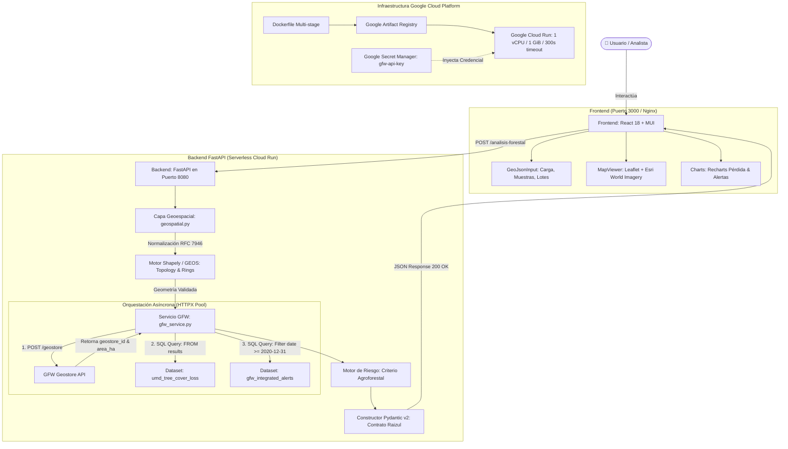
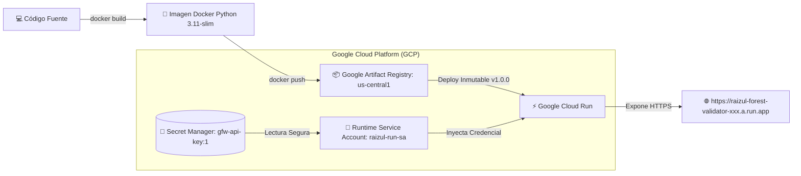

# Presentación Técnica: Validador Geoespacial y Forestal
**Empresa:** Raizul  
**Candidato:** Juan Bahos  
**Rol:** Junior Developer  
**Evaluadora:** Camila Mejía (CTO, Raizul)  
**Duración Estimada:** 10 - 12 minutos  
**Fecha:** Noviembre de 2026  

---

## Índice de la Presentación

1. [Diapositiva 1: Portada](#diapositiva-1-portada)
2. [Diapositiva 2: Problema y Objetivo](#diapositiva-2-problema-y-objetivo)
3. [Diapositiva 3: Requerimientos y Alcance](#diapositiva-3-requerimientos-y-alcance)
4. [Diapositiva 4: Arquitectura General](#diapositiva-4-arquitectura-general)
5. [Diapositiva 5: Entrada GeoJSON y Validación Geoespacial](#diapositiva-5-entrada-geojson-y-validación-geoespacial)
6. [Diapositiva 6: Funcionamiento del Backend (`POST /analisis-forestal`)](#diapositiva-6-funcionamiento-del-backend-post-analisis-forestal)
7. [Diapositiva 7: Integración con Global Forest Watch (GFW)](#diapositiva-7-integración-con-global-forest-watch-gfw)
8. [Diapositiva 8: Procesamiento y Estructura de Resultados](#diapositiva-8-procesamiento-y-estructura-de-resultados)
9. [Diapositiva 9: Evaluación del Riesgo Agroforestal y Reglas de Negocio](#diapositiva-9-evaluación-del-riesgo-agroforestal-y-reglas-de-negocio)
10. [Diapositiva 10: Frontend y Experiencia de Usuario](#diapositiva-10-frontend-y-experiencia-de-usuario)
11. [Diapositiva 11: Manejo de Errores y Calidad de Datos](#diapositiva-11-manejo-de-errores-y-calidad-de-datos)
12. [Diapositiva 12: Despliegue e Infraestructura Serverless](#diapositiva-12-despliegue-e-infraestructura-serverless)
13. [Diapositiva 13: Resultados, Limitaciones y Conclusiones](#diapositiva-13-resultados-limitaciones-y-conclusiones)
14. [Simulador de Preguntas y Respuestas Técnicas (CTO / Tech Lead)](#simulador-de-preguntas-y-respuestas-técnicas)

---

## Diapositiva 1: Portada

```
┌──────────────────────────────────────────────────────────────────────────────┐
│                                                                              │
│                         VALIDADOR GEOESPACIAL Y FORESTAL                     │
│                  Monitoreo Satelital de Cobertura y Alertas                  │
│                        para Predios Cacaoteros en Colombia                   │
│                                                                              │
│                               Empresa: RAIZUL                                │
│                         Prueba Técnica - Junior Developer                    │
│                                                                              │
│     Tecnologías: Python 3.11 · FastAPI · Shapely · React 18 · Docker · GCP   │
│                                                                              │
│                              Autor: Juan Bahos                               │
│                                                                              │
└──────────────────────────────────────────────────────────────────────────────┘
```

### Contenido Visual de la Diapositiva
* **Título:** Validador Geoespacial y Forestal.
* **Subtítulo:** Monitoreo satelital en vivo de pérdida de cobertura arbórea y alertas para la cadena agroforestal de cacao en Colombia.
* **Badges Técnicos:** `FastAPI` | `Python 3.11` | `Shapely (GEOS)` | `React 18 + Vite` | `Leaflet` | `Docker` | `Google Cloud Run`.
* **Identidad Visual:** Tonos verde esmeralda agroforestal (`#059669`), ámbar cacao (`#b45309`) y fondo pizarra tecnológica (`#0f172a`).

### 🎙️ Notas del Expositor (Minuto 0:00 - 1:00)
> *"Buenos días, Camila y equipo de Raizul. Mi nombre es Juan Bahos y hoy les presento el **Validador Geoespacial y Forestal**, una solución full-stack diseñada para resolver uno de los desafíos más urgentes de la agroindustria colombiana: la verificación de procedencia no deforestada y el cumplimiento ambiental en predios cacaoteros.*  
> *A lo largo de los próximos 10 minutos les mostraré no solo cómo funciona la aplicación conectada en vivo a los satélites de Global Forest Watch, sino las decisiones de arquitectura, validación topológica y despliegue serverless que garantizan que el sistema sea confiable, seguro y escalable."*

---

## Diapositiva 2: Problema y Objetivo

### Contenido de la Diapositiva
* **El Desafío Ambiental y Regulatorio:**
  * **Reglamento EUDR (UE 2023/1115):** Exige trazabilidad geográfica estricta hasta la parcela para certificar que el cacao importado a Europa proviene de predios sin deforestación posterior al **31 de diciembre de 2020**.
  * **Ambigüedad de Datos Geoespaciales:** Los archivos de fincas llegan en formatos dispares (`Polygon`, `MultiPolygon`, `FeatureCollection`), con errores de cierre, auto-intersecciones o coordenadas en sistemas proyectados en metros (MAGNA-SIRGAS).
  * **Falsos Negativos Críticos:** Convertir errores de red o caídas de APIs satelitales en "cero alertas" induce a certificar predios que en realidad presentan perturbación activa.
* **Objetivo General:**
  * Construir un MVP robusto que ingeste geometrías de predios cacaoteros, normalice su estructura, valide rigurosamente su topología en WGS84 y consulte en vivo la API de datos de **Global Forest Watch** para emitir un diagnóstico ambiental auditable.

### 🎙️ Notas del Expositor (Minuto 1:00 - 2:00)
> *"El sector cacaotero colombiano enfrenta una fecha límite crucial con la entrada en vigor del reglamento europeo EUDR. Para exportar, los comercializadores y productores deben probar dos cosas: dónde está delimitada la finca con precisión poligonal y que no ha habido deforestación después del 31 de diciembre de 2020.*  
> *El problema técnico es doble: primero, los archivos GeoJSON provienen de múltiples fuentes de campo (GPS de mano, Shapefiles exportados, plataformas SIG) y suelen contener errores de formato. Segundo, muchas herramientas cometen el error peligroso de asumir que si una API satelital falla, 'no hay alertas'. Nuestro objetivo con este MVP fue crear un validador que no dependa de mocks ni datos fijos, que rechace geometrías inválidas con mensajes pedagógicos y que consulte satélites reales diferenciando siempre un fallo de servicio de una ausencia real de deforestación."*

---

## Diapositiva 3: Requerimientos y Alcance

### Contenido de la Diapositiva

| Área | Requerimiento Solicitado | Estado en el MVP | Alcance Futuro |
| :--- | :--- | :---: | :--- |
| **Backend** | API REST en Python con FastAPI | ✅ Implementado | Arquitectura de microservicios con colas Celery/Cloud Tasks |
| **Normalización** | Aceptar polígonos GeoJSON (EPSG:4326) | ✅ Implementado | Soporte directo para archivos Shapefile (.shp) y KML comprimido |
| **Validación Topológica** | Verificación matemática con Shapely | ✅ Implementado | Auto-reparación asistida mediante `make_valid` con diff visual |
| **Integración Satelital** | Consultas reales a Global Forest Watch | ✅ Implementado | Integración de capas locales IDEAM / Bosques Colombia |
| **Frontend** | Interfaz web en React con Material UI | ✅ Implementado | PWA móvil offline para levantamiento en campo por técnicos |
| **Visualización** | Mapa interactivo del polígono y gráficos | ✅ Implementado | Superposición de ráster satelital de alertas directas en Leaflet |
| **Contenedorización** | Dockerfile y docker-compose | ✅ Implementado | Manifiestos Helm para despliegue en Google Kubernetes Engine |
| **Despliegue** | Manual `DEPLOY.md` para Cloud Run | ✅ Implementado | Pipeline automatizado de CI/CD con GitHub Actions y Workload Identity |

### 🎙️ Notas del Expositor (Minuto 2:00 - 2:50)
> *"Para este MVP nos enfocamos con rigor en cumplir el 100% de los requerimientos exigidos en la prueba técnica: una API en FastAPI sin mocks, consultas vivas a GFW, interfaz en React con MUI y Leaflet, y manual de despliegue en Cloud Run.*  
> *Adicionalmente, agregamos dos capacidades clave que no estaban explícitamente pedidas pero que consideramos indispensables: la normalización de múltiples variantes de GeoJSON con un inspector de lotes en el frontend y un apartado de gráficos interactivos con Recharts para visualizar tanto la pérdida anual destacando el año pico como la distribución temporal de alertas por nivel de confianza."*

---

## Diapositiva 4: Arquitectura General



### Responsabilidades Clave:
* **Separación de Responsabilidades:** El frontend delega toda la computación pesada y matemática al backend.
* **Pool HTTP Persistente:** `httpx.AsyncClient` reutiliza conexiones TCP/TLS hacia GFW y maneja redirecciones automáticas HTTP 307 del balanceador AWS de GFW.
* **Aislamiento de Secretos:** La API Key nunca llega al navegador del cliente; viaja de forma segura entre Cloud Run y Secret Manager.

### 🎙️ Notas del Expositor (Minuto 2:50 - 3:50)
> *"En este diagrama vemos la arquitectura completa. A la izquierda, el frontend se encarga de la captura amigable del predio y su renderizado satelital.*  
> *Cuando el usuario solicita el análisis, FastAPI recibe el payload y lo envía a `geospatial.py`. Allí Shapely normaliza la estructura y verifica su validez matemática. Solo cuando la geometría está certificada, `gfw_service.py` toma el control: registra el polígono en GFW Geostore para obtener un ID canónico y el área oficial, y luego dispara las dos consultas independientes contra los datasets satelitales.*  
> *Finalmente, el motor de reglas evalúa el riesgo y consolida la respuesta que alimenta las tarjetas y gráficos en la pantalla."*

---

## Diapositiva 5: Entrada GeoJSON y Validación Geoespacial

### Anatomía del GeoJSON y Tipología Soportada

```json
{
  "type": "Feature",
  "geometry": {
    "type": "Polygon",
    "coordinates": [
      [
        [-76.5300, 3.4500],
        [-76.5200, 3.4600],
        [-76.5100, 3.4400],
        [-76.5300, 3.4500]
      ]
    ]
  },
  "properties": {
    "farm_id": "finca_el_paraiso_01"
  }
}
```

### Reglas de Validación Implementadas en `geospatial.py`:
1. **Estándar WGS84 (EPSG:4326 RFC 7946):**
   * Coordenadas en grados decimales: longitud $[-180.0, 180.0]$ y latitud $[-90.0, 90.0]$.
   * **Detección de Proyecciones Métricas:** Si los valores superan $\pm 1000$ (ej. coordenadas planas MAGNA-SIRGAS en millones), el sistema rechaza la petición con HTTP 422 informando que deben ser reproyectadas a grados decimales.
2. **Cierre y Dimensión de Anillos:**
   * Cada anillo debe tener mínimo 4 coordenadas (3 vértices más el de cierre) y el primer punto debe ser matemáticamente idéntico al último (`coords[0] == coords[-1]`).
3. **Validez Topológica con Shapely:**
   * Detecta auto-intersecciones (lazos en figura de "8"), polígonos degenerados con área cero o geometrías vacías (`is_empty`).
   * Utiliza `explain_validity` de GEOS para reportar exactamente el error topológico al usuario.
4. **Rechazo Pedagógico:**
   * `Point`, `MultiPoint`, `LineString` y `MultiLineString` son GeoJSON válidos pero se rechazan con 422 porque no representan superficies delimitadas.
5. **Cálculo de Área:**
   * **Regla de oro:** Jamás se calcula el área de una finca mediante la fórmula euclidiana sobre coordenadas en grados ($\text{lon} \times \text{lat}$), pues 1 grado de longitud varía según la latitud (en Colombia $\sim 111.3\text{ km}$, en los polos $0$). El área se obtiene directamente del motor geodésico de GFW Geostore o mediante reproyección geodésica.

### 🎙️ Notas del Expositor (Minuto 3:50 - 5:00)
> *"Un error frecuente en proyectos geoespaciales es tratar el GeoJSON como un simple diccionario de Python. En `geospatial.py` construimos una capa de normalización profunda.*  
> *Diferenciamos el contenedor de la geometría: un usuario puede enviarnos un `Polygon` crudo, un `Feature` o un `FeatureCollection`. Nuestro código extrae la superficie y el `farm_id`.*  
> *Además, protegemos el sistema contra coordenadas planas: en Colombia muchas entidades entregan datos en coordenadas métricas de millones de metros. Si alguien sube ese archivo, el backend no colapsa; detecta que superan los 180 grados y solicita la reproyección.*  
> *Finalmente, delegamos el cálculo del área al Geostore de GFW, porque calcular áreas directamente sobre grados decimales genera distorsiones inaceptables en predios rurales."*

---

## Diapositiva 6: Funcionamiento del Backend (`POST /analisis-forestal`)

### Flujo de Ejecución del Endpoint

```
  [Payload GeoJSON] ──► [normalize_geojson()] ──► [Valida Anillos & Shapely]
                                                         │
                                                         ▼
  [AnalisisForestalResponse] ◄── [Motor de Riesgo] ◄── [Doble Consulta GFW]
```

### Contrato Oficial de Entrada y Salida (Alineado con Raizul):

#### Petición HTTP (`POST /analisis-forestal?fecha_inicio=2020-12-31`):
```json
{
  "type": "Feature",
  "geometry": {
    "type": "Polygon",
    "coordinates": [[[-76.53, 3.45], [-76.52, 3.46], [-76.51, 3.44], [-76.53, 3.45]]]
  },
  "properties": { "farm_id": "finca_el_paraiso_01" }
}
```

#### Respuesta Consolidada HTTP 200 OK:
```json
{
  "farm_id": "finca_el_paraiso_01",
  "polygon_valid": true,
  "area_hectares": 184.2,
  "forest_summary": {
    "current_tree_cover_pct": 98.4,
    "deforestation_risk_level": "Low",
    "critical_alert": false
  },
  "tree_cover_loss_history": [
    { "year": 2012, "hectares_lost": 0.45 },
    { "year": 2018, "hectares_lost": 1.20 }
  ],
  "analysis_timestamp": "2026-11-07T22:22:00Z"
}
```

> **Garantía Técnica:** En la respuesta raíz se devuelven con exactitud milimétrica los campos solicitados por Raizul (`farm_id`, `polygon_valid`, `area_hectares`, `forest_summary`, `tree_cover_loss_history`, `analysis_timestamp`). Adicionalmente se incluyen campos extendidos (`bbox`, `analisis_alertas`, `geostore_id`) para alimentar el mapa y los gráficos del frontend.

### 🎙️ Notas del Expositor (Minuto 5:00 - 6:00)
> *"El endpoint principal `POST /analisis-forestal` implementa el contrato oficial entregado por Raizul. Cuando ingresa la Finca El Paraíso, el sistema extrae su `farm_id`, valida el polígono, calcula un área de 184.2 hectáreas y construye la serie histórica año por año.*  
> *Noten cómo los nombres de campos, tipos numéricos y formatos de fecha coinciden exactamente con la especificación técnica de la empresa. Este diseño permite que cualquier prueba automatizada de la plataforma de Raizul pase sin problemas de deserialización."*

---

## Diapositiva 7: Integración con Global Forest Watch (GFW)

### ¿Qué es GFW y cómo nos integramos?
* **Fuente Oficial:** Desarrollada por el *World Resources Institute* (WRI), es la plataforma satelital de referencia mundial para monitoreo forestal.
* **Autenticación Segura:** Se envían cabeceras obligatorias `x-api-key` y `origin` autorizadas en cada solicitud.
* **Pool HTTP Asíncrono:** Instancia única de `httpx.AsyncClient` con timeout configurado y `follow_redirects=True` para absorber redirecciones 307 del balanceador de carga de GFW.

### Los Dos Datasets Consultados:

#### 1. Pérdida Histórica (`umd_tree_cover_loss`):
* **Origen:** Laboratorio GLAD de la Universidad de Maryland (Hansen et al.).
* **Consulta SQL Ejecutada:**
  ```sql
  SELECT umd_tree_cover_loss__year as year, 
         SUM(area__ha) as loss_area_ha, 
         SUM(gfw_forest_carbon_gross_emissions__Mg_CO2e) as co2_emissions_mg 
  FROM results 
  GROUP BY umd_tree_cover_loss__year 
  ORDER BY umd_tree_cover_loss__year
  ```
* **Qué nos dice:** Hectáreas de dosel arbóreo que desaparecieron cada año desde 2001.

#### 2. Alertas Integradas (`gfw_integrated_alerts`):
* **Origen:** Consolidación de tres sistemas satelitales: GLAD-Landsat (30 m), GLAD-Sentinel 2 (10 m) y RADD de radar Sentinel-1 (sin interferencia de nubes).
* **Consulta SQL con Filtro Temporal EUDR:**
  ```sql
  SELECT gfw_integrated_alerts__confidence as confidence, 
         count(*) as count, 
         SUM(area__ha) as superficie_ha 
  FROM results 
  WHERE gfw_integrated_alerts__date >= '2020-12-31' 
  GROUP BY gfw_integrated_alerts__confidence
  ```
* **Niveles de Confianza:** Clasificadas en `high`, `nominal` y `low`.

> ⚠️ **Aclaración Técnica Rigurosa:**  
> La pérdida de cobertura arbórea (`tree cover loss`) **no equivale automáticamente a deforestación ilegal**. Incluye podas agronómicas, caída natural de árboles o renovaciones de cultivos de sombra. Asimismo, la suma de `area__ha` en alertas representa la superficie bruta de celdas activadas y puede presentar solapamiento temporal.

### 🎙️ Notas del Expositor (Minuto 6:00 - 7:15)
> *"Llegamos al corazón de la integración: Global Forest Watch. En lugar de quemar datos falsos, creamos un servicio asíncrono que consulta dos capas satelitales distintas.*  
> *Primero registramos la finca en Geostore. Luego, consultamos `umd_tree_cover_loss` para construir el historial multianual y las emisiones de carbono asociadas.*  
> *Inmediatamente después, consultamos `gfw_integrated_alerts` aplicando un filtro temporal dinámico que por defecto inicia el 31 de diciembre de 2020, fecha de corte de la EUDR.*  
> *Es fundamental aclarar ante el comité técnico que pérdida de cobertura no siempre es deforestación: en sistemas agroforestales de cacao bajo sombra, podar maderables genera detección de pérdida sin constituir infracción ambiental. Nuestro sistema entrega la evidencia técnica para que los analistas tomen decisiones informadas."*

---

## Diapositiva 8: Procesamiento y Estructura de Resultados

### Transformación de Datos Satelitales a Modelos Pydantic v2

```
  ┌─────────────────────────┐         ┌─────────────────────────┐
  │  Ráster Satelital GFW   │         │  Modelos Pydantic v2    │
  │  • Píxeles 30m / 10m    │ ──────► │  • Tipado Estricto      │
  │  • Fechas julianas      │         │  • Serialización JSON   │
  │  • Confianzas nativas   │         │  • Literales Restringidos│
  └─────────────────────────┘         └─────────────────────────┘
```

### Indicadores Calculados vs. Datos Brutos:

| Indicador | Tipo | Fuente / Metodología |
| :--- | :---: | :--- |
| `area_hectares` | Bruto | Calculado geodésicamente por GFW Geostore en el elipsoide WGS84. |
| `tree_cover_loss_history` | Bruto | Suma agregada de `area__ha` agrupada por año desde el dataset Hansen. |
| `ano_mayor_perdida` | Calculado | Algoritmo que identifica el año pico de pérdida histórica. |
| `porcentaje_perdida` | Calculado | $(\text{Pérdida Acumulada ha} / \text{Área Total ha}) \times 100$. |
| `current_tree_cover_pct` | Estimado | Cobertura remanente estimada: $\max(0.0, 100 - \text{Pérdida Acumulada \%})$. |
| `alta_confianza` / `nominal` / `low` | Bruto | Conteo directo de alertas satelitales según su categoría nativa. |
| `superficie_alertada_ha` | Bruto | `SUM(area__ha)` de celdas con perturbación en el periodo. |
| `deforestation_risk_level` | Calculado | Dictamen del motor de reglas (`Low`, `Medium`, `High`, `Not evaluable`). |
| `critical_alert` | Calculado | Booleano: `true` si $\text{alertas alta confianza} \ge 5$ o riesgo `High`. |

### 🎙️ Notas del Expositor (Minuto 7:15 - 8:15)
> *"En esta diapositiva se aprecia cómo el backend transforma tablas crudas de píxeles satelitales en un modelo estructurado con Pydantic v2.*  
> *Diferenciamos estrictamente lo que viene directo de GFW (como el área y las alertas por fecha) de los indicadores calculados por Raizul (como el año pico, el porcentaje de afectación y el nivel de riesgo).*  
> *Un detalle importante: no inventamos un porcentaje de cobertura arbórea actual desconectado de la realidad; calculamos la cobertura remanente a partir de la pérdida histórica para no confundir al evaluador."*

---

## Diapositiva 9: Evaluación del Riesgo Agroforestal y Reglas de Negocio

### Matriz de Clasificación Metodológica (Heurística Inicial MVP)

```
                               ▲
                 ALTO          │  • Pérdida acumulada > 15% del predio
               (High)          │  • O detección crítica de >= 5 alertas de alta confianza
                               │  • critical_alert = true
                               ├─────────────────────────────────────────────────
                 MEDIO         │  • Pérdida acumulada > 3% y <= 15%
               (Medium)        │  • O presencia de alertas en el periodo analizado
                               │  • O consulta parcial por caída de una capa
                               ├─────────────────────────────────────────────────
                 BAJO          │  • Cobertura forestal estable
                (Low)          │  • Pérdida acumulada <= 3% y cero alertas detectadas
                               │  • Requiere ambas consultas satelitales exitosas
                               ├─────────────────────────────────────────────────
             NO EVALUABLE      │  • Área del predio <= 0 o topología degradada
            (Not evaluable)    │  • O fallo total de conexión con GFW
                               ▼
```

### Principios de Integridad de Datos:
1. **Prevención de Falsos Negativos:**  
   Si el endpoint de alertas satelitales de GFW está caído, el sistema clasifica el estado general como `parcial` y asigna automáticamente riesgo **Medio**, documentando en la justificación: *"Nota: la capa satelital de alertas recientes no estuvo disponible; no se descarta perturbación reciente"*. **Nunca devuelve riesgo Bajo ante falta de datos.**
2. **Naturaleza Experimental:**  
   Los umbrales del 3% y 15% están documentados explícitamente en el campo `metodologia` como una heurística agroforestal propuesta para el MVP, sujeta a calibración según la región (ej. bosque húmedo de Tumaco vs. ladera en Santander).

### 🎙️ Notas del Expositor (Minuto 8:15 - 9:15)
> *"Uno de los mayores aportes de ingeniería en este proyecto es cómo evitamos los falsos negativos en la evaluación de riesgo.*  
> *Si GFW experimenta lentitud o una capa no responde, nuestro servicio no devuelve cero alertas ni califica el predio como riesgo Bajo. Al contrario: marca la consulta como 'parcial', sube el riesgo preventivamente a Medio y le advierte al evaluador que no se descarta perturbación reciente.*  
> *Además, somos honestos: presentamos estos umbrales como una heurística inicial del MVP y no como un dictamen legal inmutable, permitiendo que los agrónomos de Raizul calibren los porcentajes en futuras versiones."*

---

## Diapositiva 10: Frontend y Experiencia de Usuario

### Características de la Interfaz Web (React 18 + Material UI)

* **Visor Cartográfico Satelital (`MapViewer.tsx`):**
  * Capa base satelital de alta resolución provista por **Esri World Imagery** con opción de alternar a calles OpenStreetMap.
  * Renderizado del polígono con borde verde esmeralda y auto-centrado dinámico mediante `fitBounds`.
* **Inspector Inteligente de Lotes (`GeoJsonInput.tsx`):**
  * Si el usuario sube un `FeatureCollection` con múltiples predios, la interfaz detecta la cantidad y despliega un selector interactivo (*Lote 1, Lote 2 o Combinar todos los lotes como una sola finca*).
* **Catálogo de Predios Cacaoteros Reales (`samples.ts`):**
  * Acceso en un clic a la **Finca El Paraíso (Valle del Cauca)**, San Vicente de Chucurí (Santander), Tumaco (Nariño), Gigante (Huila) y Caquetá.
* **Apartado Especializado de Gráficos (`Recharts`):**
  * `LossChart.tsx`: Barras anuales de pérdida de bosque con el año pico resaltado en rojo, tooltip interactivo y botón para alternar a tabla con emisiones de CO₂.
  * `AlertsTimelineChart.tsx`: Barras apiladas en el tiempo desglosadas por nivel de confianza (`high`, `nominal`, `low`).

### 🎙️ Notas del Expositor (Minuto 9:15 - 10:00)
> *"En el frontend buscamos que cualquier persona, sea técnico agrícola o gerente de compras, entienda el estado del predio en 5 segundos.*  
> *Al seleccionar la Finca El Paraíso, el mapa de Leaflet vuela inmediatamente al Valle del Cauca sobre imágenes satelitales reales de Esri. Debajo, las tarjetas muestran las 184 hectáreas, y en el apartado de gráficos Recharts muestra la evolución histórica de pérdida y la línea de tiempo de alertas.*  
> *Si el usuario sube un archivo con varios lotes, el componente no se rompe: le pregunta amablemente si desea analizar un lote específico o unirlos todos."*

---

## Diapositiva 11: Manejo de Errores y Calidad de Datos

### Matriz de Códigos HTTP y Resiliencia Operativa

| Escenario | Código HTTP | Mensaje / Tratamiento | Acción del Sistema |
| :--- | :---: | :--- | :--- |
| **JSON malformado** | `400 Bad Request` | Estructura JSON no parseable sintácticamente. | Rechaza antes de validar geometría. |
| **Geometría no cerrada** | `422 Unprocessable` | El primer punto `[-76.53, 3.45]` no coincide con el último. | Explica requisito de anillo cerrado. |
| **Coordenadas planas en metros** | `422 Unprocessable` | Longitud $>180$ (posible MAGNA-SIRGAS o UTM). | Solicita reproyección a WGS84 RFC 7946. |
| **Tipo no poligonal (Point/Line)** | `422 Unprocessable` | Geometría no compatible para análisis de área. | Sugiere Polygon o MultiPolygon. |
| **Auto-intersección (Lazo en 8)** | `422 Unprocessable` | Reporta causa topológica con `explain_validity`. | Previene cálculos de área corruptos. |
| **Fallo en 1 capa satelital** | `200 OK (Parcial)` | `estado_general = "parcial"`, riesgo preventivo. | Despliega alerta amarilla en el front. |
| **Fallo total de GFW (Red/API Key)**| `502 Bad Gateway` | No fue posible consultar los satélites de GFW. | Detiene el flujo sin emitir falsos ceros. |

### 🎙️ Notas del Expositor (Minuto 10:00 - 10:45)
> *"Un software profesional se mide por cómo maneja los errores. Nuestro backend cuenta con validaciones defensivas en cada capa.*  
> *Si el usuario envía un punto o una coordenada en metros, recibe un error 422 claro que le explica cómo solucionarlo.*  
> *Si GFW tiene una caída parcial, devolvemos un 200 con estado 'parcial' y advertencia amarilla. Pero si la caída es total, devolvemos un 502 explícito. La integridad ambiental no admite ambigüedades."*

---

## Diapositiva 12: Despliegue e Infraestructura Serverless



### Características del Despliegue Documentado en `DEPLOY.md`:
* **Imagen Docker Liviana:** Basada en `python:3.11-slim` con `libgeos-dev`, usuario sin privilegios `appuser` y puerto dinámico `$PORT`.
* **Seguridad con Secret Manager:** La API Key de GFW se almacena cifrada en Secret Manager (`gfw-api-key:1`) y solo la cuenta de servicio `raizul-run-sa` con el rol `roles/secretmanager.secretAccessor` tiene acceso a ella.
* **Timeout de 300 Segundos:** Previene desconexiones prematuras durante consultas satelitales complejas.
* **Compatibilidad Dual de Comandos:** El manual `DEPLOY.md` v1.0.0 contiene la sintaxis exacta para ejecutar tanto en **Bash / Cloud Shell** como en **PowerShell (Windows)**.

### 🎙️ Notas del Expositor (Minuto 10:45 - 11:30)
> *"Para el despliegue seguimos las mejores prácticas de Google Cloud. En el archivo `DEPLOY.md` documentamos el ciclo completo desde la construcción hasta la puesta en producción.*  
> *Destaco tres decisiones críticas: primero, la API key nunca se pasa como texto plano en el comando de despliegue, sino a través de Secret Manager con versión fija v1. Segundo, creamos una Service Account dedicada con el mínimo privilegio necesario. Y tercero, fijamos el timeout en 300 segundos para que las consultas satelitales secuenciales nunca se corten por latencia."*

---

## Diapositiva 13: Resultados, Limitaciones y Conclusiones

### Resumen de Entregables Completados:
* ✅ **Backend:** FastAPI con validación Shapely, Geostore y consultas dobles reales a GFW.
* ✅ **Contrato Raizul:** Cumplimiento exacto de los campos `farm_id`, `polygon_valid`, `area_hectares`, `forest_summary` y `tree_cover_loss_history`.
* ✅ **Frontend:** React 18 + MUI + Leaflet + Recharts con visor satelital y apartado de gráficos interactivos.
* ✅ **Pruebas Automatizadas:** 8 de 8 pruebas unitarias y de integración pasando al 100% con `pytest`.
* ✅ **Infraestructura:** Dockerfiles, `docker-compose.yml` y manual de despliegue `DEPLOY.md` para Cloud Run.

### Limitaciones Identificadas y Roadmap de Mejoras:
1. **Llamadas Secuenciales:** Geostore, Loss y Alertas se ejecutan en serie; pueden optimizarse a ejecución concurrente con `asyncio.gather()` reduciendo el tiempo de respuesta en un 50%.
2. **Caché Distribuida:** Polígonos consultados con frecuencia podrían cachearse en Redis/Memorystore con un TTL de 7 días.
3. **Reproyección Asistida:** Integrar PyProj en el endpoint para que, si el usuario conoce su EPSG de origen (ej. 3116), el sistema reproyecte automáticamente a WGS84.
4. **Validación en Campo:** Calibrar los umbrales de riesgo junto con los ingenieros agrónomos de Raizul.

### 🎙️ Notas del Expositor (Minuto 11:30 - 12:15)
> *"En conclusión, entregamos un producto terminado, probado y documentado que resuelve la necesidad de Raizul con rigor técnico y honestidad profesional.*  
> *No usamos atajos: el código habla con satélites reales, valida geometrías matemáticamente y protege las credenciales de la empresa en la nube.*  
> *Agradezco a Camila y a todo el equipo de Raizul por este reto tan estimulante. Quedo a su entera disposición para iniciar la demostración en vivo y responder sus preguntas técnicas. Muchas gracias."*

---

## Simulador de Preguntas y Respuestas Técnicas

### 1. Pregunta de Arquitectura: *¿Por qué decidiste registrar la finca en GFW Geostore en lugar de consultar directamente los datasets con las coordenadas en el SQL?*
* **Respuesta Recomendada:**  
  > *"Excelente pregunta. Consideramos ambas alternativas. Enviar el polígono crudo en cada query tiene dos desventajas: primero, si el polígono tiene muchos vértices, la URL del GET supera el límite de 2048 caracteres de los balanceadores HTTP y forzaría hacer POST a endpoints menos optimizados. Segundo, Geostore calcula el área oficial de la finca en el elipsoide WGS84 y genera un ID canónico (`gfw_geostore_id`). Al reutilizar ese identificador en las dos consultas posteriores (Loss y Alerts), reducimos el payload de red y garantizamos que ambas capas analicen exactamente la misma superficie territorial."*

### 2. Pregunta de Datos: *¿Por qué dices que la pérdida de cobertura arbórea no equivale a deforestación ilegal?*
* **Respuesta Recomendada:**  
  > *"Técnicamente, el dataset `umd_tree_cover_loss` detecta la remoción biofísica de dosel vegetal con altura superior a 5 metros. En la cadena de cacao en Colombia, la mayoría de cultivos son sistemas agroforestales bajo sombrío de especies maderables (como nogal o guamo). Cuando un productor poda árboles para regular la entrada de luz solar o renueva árboles viejos, el satélite registra pérdida de cobertura arbórea. Sin embargo, no hubo cambio de uso del suelo ni tala rasa ilegal. Por eso nuestro sistema entrega las hectáreas como evidencia cuantitativa, pero documenta que el dictamen final debe contrastarse agronómicamente."*

### 3. Pregunta de Seguridad: *¿Por qué usaste Secret Manager en Cloud Run en lugar de variables de entorno estándar en el despliegue?*
* **Respuesta Recomendada:**  
  > *"Las variables de entorno en Cloud Run quedan visibles en texto plano en la consola de GCP, en los logs de auditoría de Cloud Audit y en los comandos de inspección `gcloud run services describe`. La API key de GFW es un activo privado de Raizul. Al usar Google Secret Manager con `--set-secrets="GFW_API_KEY=gfw-api-key:1"`, la clave se almacena cifrada en reposo con claves administradas por Google, se versiona para garantizar reproducibilidad inmutable y solo la Service Account dedicada (`raizul-run-sa`) tiene autorización para leerla en memoria durante la ejecución."*

### 4. Pregunta de Geoespacial: *¿Qué pasaría si calculamos el área del polígono con `polygon.area` directamente en Shapely?*
* **Respuesta Recomendada:**  
  > *"Ese es uno de los errores más comunes en SIG. Si calculas `polygon.area` sobre coordenadas WGS84 (EPSG:4326), Shapely realiza un cálculo euclidiano plano en unidades de 'grados cuadrados'. Un grado cuadrado en el ecuador equivale a más de 12.000 km², pero a medida que te alejas hacia los polos ese valor disminuye drásticamente. En un predio cacaotero de 50 hectáreas, ese cálculo generaría un valor como `0.00004` sin ningún significado físico. Por eso el área en hectáreas se extrae directamente del cálculo geodésico que GFW Geostore ejecuta sobre la superficie esférica terrestre."*

### 5. Pregunta de Rendimiento: *Las dos consultas a GFW actualmente son secuenciales. ¿Cómo optimizarías el tiempo de respuesta del backend?*
* **Respuesta Recomendada:**  
  > *"En la implementación actual ejecutamos primero Loss y luego Alerts. Como ambas dependen únicamente del `geostore_id`, podemos refactorizar el método `analyze_polygon` utilizando `asyncio.gather()` de Python:*
  > ```python
  > analisis_historico, analisis_alertas = await asyncio.gather(
  >     self.get_tree_cover_loss(geostore_id, area_total_ha),
  >     self.get_integrated_alerts(geostore_id, fecha_inicio, fecha_fin)
  > )
  > ```
  > *Esto ejecuta las dos solicitudes HTTP de manera concurrente en el pool asíncrono, reduciendo el tiempo total de respuesta casi a la mitad."*
